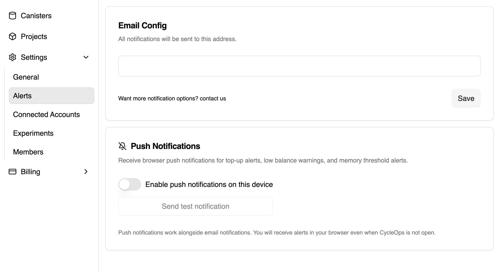
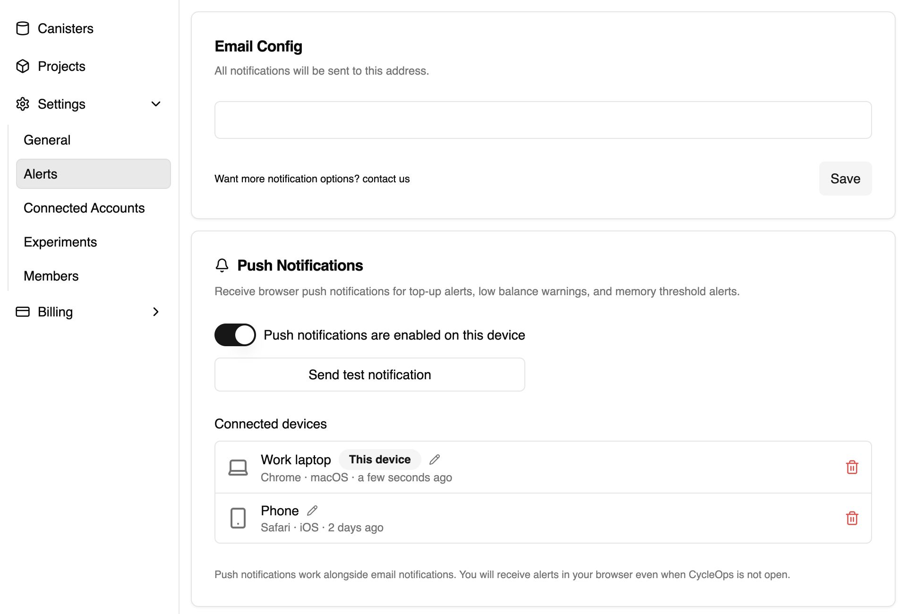

import pushAlertScreenshot from "./screenshot-push-alert.jpg";

CycleOps can now send alerts straight to your phone or favorite browser!

Push notifications work great alongside email alerts, so you can now add an additional, more familiar notification channel for top-up alerts, low balance warnings, memory threshold alerts, and other important updates without changing your current alert setup.

<!-- truncate -->

*Note: The CycleOps team recommends setting up push notifications **in addition to** (not as a replacement for) email alerts*

## How to enable push notifications

1. [Sign in to CycleOps](https://cycleops.dev).
2. In the sidebar, open **Settings**, then select **Alerts**.
3. Find **Push Notifications** and turn on **Enable push notifications on this device**.
4. When your browser asks for permission, choose **Allow**.
5. Click **Send test notification** to confirm everything is working. Test notifications can take up to five minutes to arrive.

Push is enabled per device. Repeat these steps on each browser, phone, or tablet where you want to receive CycleOps alerts.

## Set up push notifications on iPhone or iPad

Apple supports web push for Home Screen web apps on iOS and iPadOS 16.4 or later. To enable it:

1. Open [CycleOps](https://cycleops.dev) in Safari.
2. Tap the **Share** button.
3. Choose **Add to Home Screen**.
4. Open CycleOps from its new Home Screen icon.
5. Open **Settings → Alerts** and enable push notifications for the device.

*Tip: You can similarly enable push notifications on any smart phones (Samsung/Pixel/etc.) that allow for push notifications through home screen installed webapps.*

## Open an alert and take action

Tapping a CycleOps notification takes you directly to the relevant account or canister. The alert opens with current data and a clear next step, so you can understand what happened and act immediately.

  

## Manage your connected devices

You can give each push device a recognizable name or remove devices you no longer use. Turning push off on one device does not interrupt alerts on your other connected devices.

## Add push notifications to your own app

CycleOps' push notifications feature is powered by [research-ag's notification service](https://github.com/research-ag/notification-service), an open-source web push stack for Internet Computer apps. It includes a notification canister, a relayer for delivering browser notifications, a frontend SDK, and examples you can adapt for your own project.

If you want to bring push notifications to your app, visit the [research-ag/notification-service repository](https://github.com/research-ag/notification-service) for the integration and local development guide.

Ready to try it? [Sign in to CycleOps](https://cycleops.dev), open **Settings → Alerts**, and connect your first device.
