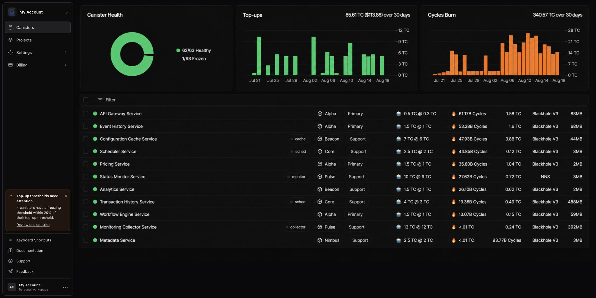
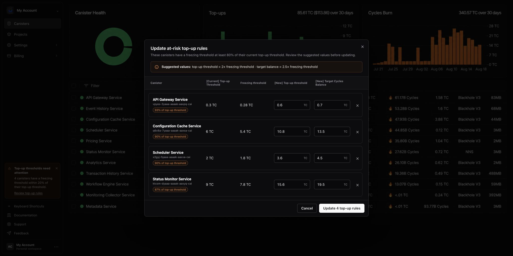
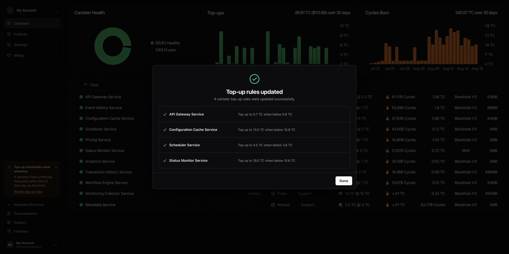

Stay ahead of canister freezing with CycleOps' new smart, safer top-up rule suggestions that are easy to review and apply.

<!-- truncate -->

## Review at-risk rules

When a freezing threshold reaches at least 80% of its top-up threshold, CycleOps displays a notification on the canisters page.

Open the notification to review every affected canister together. CycleOps suggests:

- A top-up threshold equal to 2× the freezing threshold
- A target balance equal to 2.5× the freezing threshold

You can edit the values or exclude individual canisters before applying the update.

Updates are applied together, with a confirmation showing the resulting rule for each canister.

## What's next for Adaptive Monitoring

We're exploring ways to make these suggestions more adaptive by considering each canister's burn rate and your desired maintenance buffer—not only its freezing threshold.

We're also looking into monitoring agents that can scale and adjust monitoring configurations across your canister fleet. You would be notified about every update, keeping you in control and in the loop while you stay focused on building great dapps.

Give us your [feedback](https://x.com/CycleOps) on what types of adaptive monitoring features you'd find useful.

[Sign in to CycleOps](https://cycleops.dev) to review your top-up rules, or read our [top-up rule guide](https://docs.cycleops.dev/docs/basics/topup-rules).
